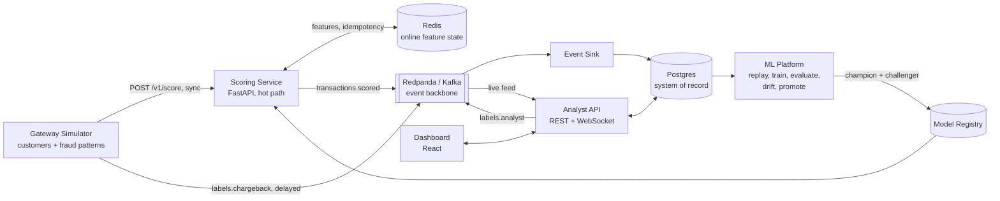

# Adaptive Real-Time Fraud Detection Pipeline

Scores card transactions in real time (p99 under 50 ms), explains every decision, and adapts on its own when fraud patterns change.

> Status: Phase 0 complete; Phase 1 (synthetic world) not started. See [the roadmap](docs/07-roadmap.md).

## What it does

A simulated payment gateway sends card authorization requests to a scoring service. For each transaction the service looks up the card's recent behaviour, combines hard rules with a LightGBM model, and returns **APPROVE**, **REVIEW**, or **DECLINE** with the top reasons, all inside a strict latency budget.

Every decision is streamed onto an event backbone. From there it is stored, shown live on an analyst dashboard, labelled (by analysts and by simulated chargebacks that arrive late, like real ones), and used to detect drift, retrain, shadow-test, and safely promote a new model.

## End goal

The project is done when every row below is true and backed by numbers in [Benchmarks](#benchmarks). Full detail in the [charter](docs/01-charter.md).

| Area | Target |
|---|---|
| Latency | p99 scoring latency under 50 ms at 500 TPS on a laptop |
| Throughput | sustains 1,000 TPS without dropping or duplicating decisions |
| Detection | beats the rules-only baseline on PR-AUC and on expected cost |
| Explainability | every decision carries its top 3 reason codes |
| Adaptation | detects an injected fraud-pattern shift, retrains, shadow-tests, and promotes without manual steps |
| Reliability | defined, tested behaviour when Redis, Kafka, Postgres, or the model fails |
| Reproducibility | `make up` starts everything; `make demo` runs the scripted demo |

## Architecture



Two paths, two sets of rules:

* **Hot path** (gateway to scoring service to Redis): synchronous, latency is everything, no database writes, no blocking network calls beyond Redis.
* **Cold path** (Kafka to everything else): asynchronous, throughput and correctness matter, latency does not.

Read [docs/02-architecture.md](docs/02-architecture.md) for the full design, the request sequence, the latency budget, and the model lifecycle.

## Repository layout

```
.
├── docs/                    Design docs, ADRs, design notes (start here)
├── libs/fraudcore/          Shared code: data contracts + feature logic used online AND offline
├── services/
│   ├── gateway-sim/         Synthetic customers, fraud attacks, chargeback labels
│   ├── scoring/             Hot path: idempotency, features, rules, model, decision
│   ├── event-sink/          Kafka to Postgres, idempotent writes
│   ├── analyst-api/         Review queue, labels, live WebSocket feed, attack controls
│   ├── ml-platform/         Replay, train, evaluate, drift, shadow, promote
│   └── dashboard/           React UI
├── infra/                   Postgres schema, topic setup, Prometheus, Grafana
├── tests/                   unit, contract, integration, chaos
├── benchmarks/              Load tests and recorded results
├── notebooks/               Exploration only; nothing production lives here
├── docker-compose.yml
└── Makefile
```

## Quickstart

```bash
cp .env.example .env
make up          # start infra + services
make topics      # create Kafka topics (first run only)
make sim         # start sending transactions
open http://localhost:8080   # Redpanda console
open http://localhost:3000   # dashboard (Phase 6)
make down
```

## Documentation map

| Doc | Read it when |
|---|---|
| [01 Charter](docs/01-charter.md) | You want the why, the end goal, and the non-goals |
| [02 Architecture](docs/02-architecture.md) | You want to understand how the pieces fit |
| [03 Data contracts](docs/03-data-contracts.md) | You touch schemas, topics, Redis keys, or tables |
| [04 Feature catalog](docs/04-feature-catalog.md) | You add or change a feature |
| [05 Model card](docs/05-model-card.md) | You train, evaluate, or pick thresholds |
| [06 Failure modes](docs/06-failure-modes.md) | You ask "what if X goes down?" |
| [07 Roadmap](docs/07-roadmap.md) | You want to know what to build next |
| [08 Runbook](docs/08-runbook.md) | You run, demo, or break the system |
| [09 Glossary](docs/09-glossary.md) | A term is unfamiliar |
| [ADRs](docs/adr/) | You want to know why a decision was made |

## Tech stack

| Concern | Choice | Why |
|---|---|---|
| Language | Python 3.12 | ML ecosystem; latency target is reachable |
| Hot path API | FastAPI + uvicorn | async, typed, fast enough for the budget |
| Event backbone | Redpanda (Kafka API) | [ADR-0003](docs/adr/0003-redpanda-as-event-backbone.md) |
| Online features | Redis | [ADR-0004](docs/adr/0004-redis-online-feature-state.md) |
| Model | LightGBM | [ADR-0005](docs/adr/0005-lightgbm-primary-model.md) |
| Storage | Postgres | system of record and training source |
| Observability | Prometheus + Grafana | latency histograms, throughput, drift |
| UI | React + TypeScript | live feed, review queue, attack controls |

## Benchmarks

Filled in as phases complete. Every number links to the script that produced it in `benchmarks/`.

| Metric | Rules baseline | LightGBM | Notes |
|---|---|---|---|
| PR-AUC | 0.122 | 0.966 | time-based holdout, [`mlp evaluate`](services/ml-platform/ml_platform/evaluate.py); per-pattern detail in the [model card](docs/05-model-card.md) |
| Recall at chosen threshold | 0.345 | 0.977 | flagged = review or decline |
| Precision at chosen threshold | 0.262 | 0.597 | thresholds chosen on validation |
| Expected cost per 1k txns | $226.77 | $38.42 | cost matrix in model card; approving everything costs $678.63 |
| Scoring p50 / p99 latency | TBD | TBD | at 500 TPS |
| Max sustained TPS | TBD | TBD | |
| Time to detect injected drift | n/a | TBD | |
