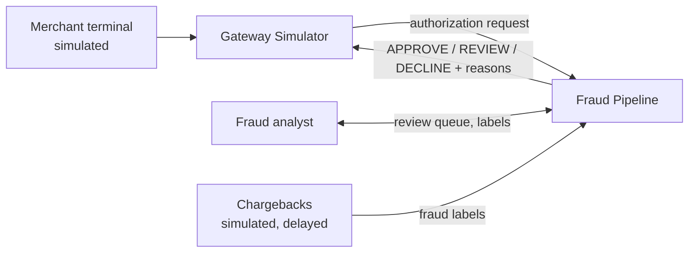
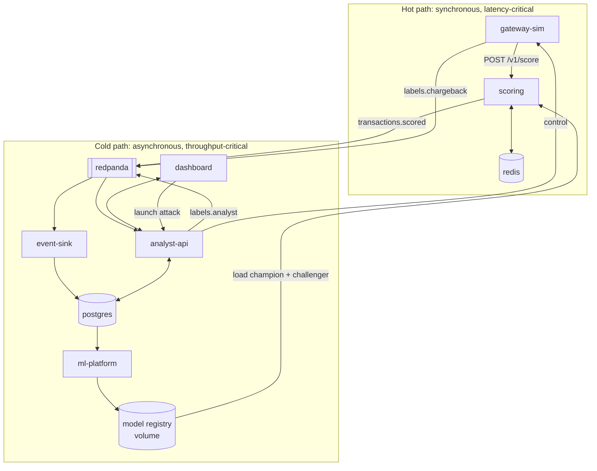
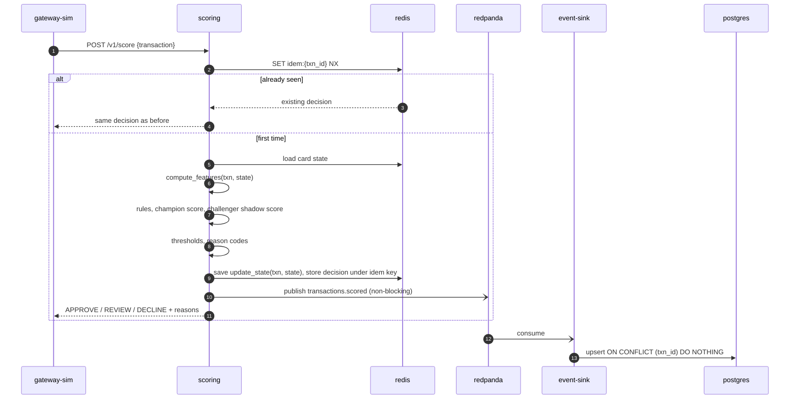
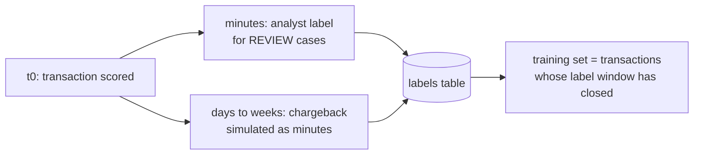
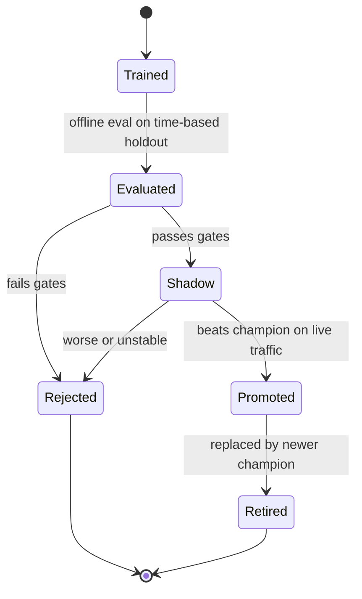
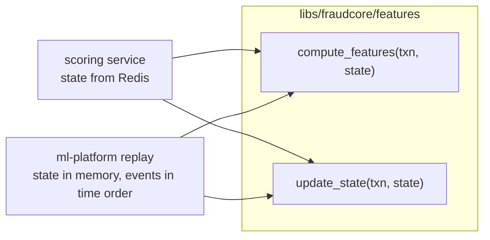

# 02 Architecture

## 1. Design principles

1. **Separate the hot path from the cold path.** Anything that is not needed to make the decision happens asynchronously.
2. **One feature implementation.** Online scoring and offline training call the same pure functions. This is how training-serving skew is prevented (ADR-0006).
3. **Point-in-time correctness.** A transaction's features only ever see events strictly before it.
4. **At-least-once everywhere, idempotent everywhere.** Duplicates will happen; they must be harmless.
5. **Degrade, do not die.** Each dependency failure has a defined fallback (doc 06).
6. **Measure before optimizing.** Every performance claim comes from a benchmark script.

## 2. System context

## 3. Containers

| Container | Responsibility | Owns | Scales by |
|---|---|---|---|
| gateway-sim | Generates customers, normal spend, attacks; sends auth requests; emits delayed chargebacks | ground truth | rate setting |
| scoring | Idempotency, features, rules, model, decision, reasons, publish | nothing durable | stateless replicas |
| redis | Per-card feature state, idempotency keys | online state | cluster, sharded by card |
| redpanda | Durable event log between services | events | partitions keyed by card_id |
| event-sink | Writes events to Postgres idempotently | nothing | consumer group members |
| postgres | System of record: transactions, decisions, labels, models | history | read replicas |
| analyst-api | Review queue, labels, live feed, metrics, attack controls | review state | replicas |
| dashboard | UI for all of the above | nothing | static |
| ml-platform | Replay features, train, evaluate, drift, promote | model artifacts | batch jobs |

## 4. One transaction, end to end

Key ordering rule: **compute features first, then update state.** If you update first, the transaction leaks into its own features and offline metrics look better than reality.

Open question to settle in Phase 4: should declined attempts update velocity state? (Hint: card-testing attacks are mostly declines.)

## 5. Latency budget (p99, target 50 ms)

| Step | Budget | Notes |
|---|---|---|
| HTTP parse + validation | 3 ms | Pydantic v2 |
| Idempotency check | 1 ms | single Redis round trip |
| Load card state | 3 ms | one round trip; pipeline if multiple keys |
| Feature computation | 1 ms | pure Python, no I/O |
| Rules | 0.5 ms | |
| Champion predict + contributions | 4 ms | LightGBM `pred_contrib=True` is TreeSHAP |
| Challenger shadow predict | 3 ms | skipped under load shedding |
| Save state + decision | 3 ms | one pipelined round trip |
| Publish to Kafka | 0 ms on path | buffered, async |
| **Total budgeted** | **18.5 ms** | headroom for GC, contention, tail latency |

If p99 blows the budget, profile first and update this table with measured numbers.

## 6. Labels arrive late

Consequences:

* Recent transactions have no label yet. Training only uses data older than the label window.
* Unlabelled approved transactions are treated as legit after the window closes. This is a known bias; document it in the model card.
* Analyst labels only exist for REVIEW cases, so they are a biased sample. Never evaluate on analyst labels alone.

## 7. Model lifecycle

* **Champion** makes the real decision. **Challenger** scores the same traffic in shadow; its score is logged, never acted on.
* Promotion gates are defined in the model card. Promotion is an atomic pointer swap in the registry; scoring reloads without restarting.

## 8. Preventing training-serving skew

Training data is built by **replaying historical events in event-time order through the exact same functions** the scoring service uses. There is no second implementation in pandas. A parity test (tests/contract) asserts that online and offline produce identical vectors for the same event sequence.

## 9. Scaling notes (not built, but designed for)

* Kafka topics are keyed by `card_id`, so all events for a card land in one partition and stay ordered.
* Scoring is stateless; scale replicas behind a load balancer.
* Redis keys use the `{card_id}` hash tag so one card's keys live on one shard in Redis Cluster.
* Concurrent requests for the same card can race on state. Phase 5 decides between optimistic locking (WATCH), Lua scripts, or routing by card.

## 10. Security and privacy

Synthetic data only. No PANs: `card_id` is an opaque token. Secrets come from environment variables, never committed. Out of scope: authN/Z, encryption at rest, PCI.
