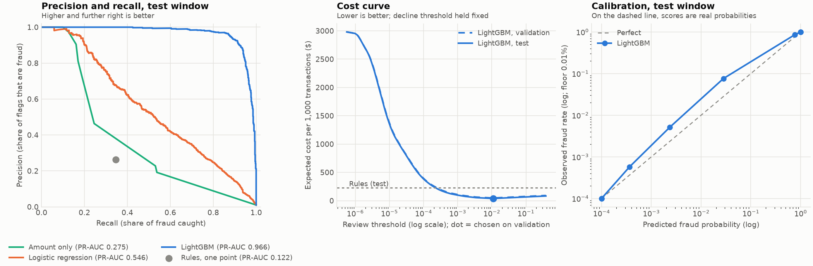

# 05 Model card

Living document. Fill in the TBDs as Phase 2 and Phase 7 complete.

## Task

Binary classification: probability that a card authorization is fraudulent.

## Label definition

`is_fraud = 1` if a chargeback or analyst label marks it fraud. `0` if labelled legit, or if unlabelled after the label window closes (bias noted below).

## Data

Synthetic, from gateway-sim (generator version 1.0.0, recorded in the Parquet file's metadata along with seed, customers, days and start). Fraud rate target about 0.5 to 1%; the default run is 1%. Fraud patterns: stolen card travel, card testing, account takeover, merchant compromise, each with an easy and a hard variant (design note: `docs/design-notes/phase-1-synthetic-world.md`). Ground truth columns (`is_fraud`, `fraud_pattern`, `attack_id`, `breached_merchant_id`) are for labels and analysis only, never features. Document the generator version used for every trained model.

## Split

**Time-based.** Train on the earliest window, validate on the next, test on the last. Never random: a random split lets the model learn from the future and inflates every metric.

## Models compared

| Model | Purpose |
|---|---|
| Rules only | business baseline; must be beaten |
| Logistic regression | simple ML baseline |
| LightGBM | primary model |
| Isolation Forest (Phase 7) | unsupervised, catches unseen patterns |

## Metrics

* **Primary: PR-AUC.** Precision-recall curves are informative under heavy imbalance; ROC-AUC looks great even for weak models here.
* **Operating point: precision and recall at the chosen thresholds.**
* **Business: expected cost per 1,000 transactions.**
* **Calibration:** reliability curve; scores are used as probabilities in the cost math.
* Never report accuracy as a headline number.

## Thresholds from a cost matrix

| Outcome | Cost (assumption, tune and justify) |
|---|---|
| Missed fraud (approved fraud) | transaction amount |
| False decline (declined legit) | $15 customer friction + churn risk |
| Review | $3 analyst time |
| Correct approve / correct decline | $0 |

Pick `review_threshold` and `decline_threshold` to minimize expected cost on the validation set, then report on test. Show the cost curve in the README.

| Threshold | Value | Chosen on |
|---|---|---|
| review | 0.0110 | validation |
| decline | 0.8852 | validation |

## Explainability

LightGBM `pred_contrib=True` returns per-feature TreeSHAP contributions at prediction time with no extra dependency. Top 3 positive contributions map to reason codes in `fraudcore/reasons.py` (for example `km_from_last_txn` to `IMPOSSIBLE_TRAVEL`).

## Results

Model v0001, trained on generator 1.1.0 data (4,000 customers, 60 days, seed 42; 519,333 transactions, 5,200 fraud). Reproduce with `python -m gateway_sim.main --offline --customers 4000 --days 60`, then `mlp replay`, `mlp train`, `mlp evaluate`. Figure: `docs/images/phase2-results.png`.

### Results for v0001 (generator 1.1.0)

Windows: test 2026-02-20 to 2026-03-02 (880 fraud), train 2026-01-01 to 2026-02-06 (3,123 fraud), val 2026-02-07 to 2026-02-19 (955 fraud)

#### Test window (thresholds chosen on validation)

| Model | PR-AUC | ROC-AUC | Precision | Recall | Reviews per 1k | Cost per 1k |
|---|---|---|---|---|---|---|
| Rules | 0.122 | 0.668 | 0.262 | 0.345 | 7.3 | $226.77 |
| Amount only | 0.275 | 0.760 | 0.464 | 0.245 | 4.4 | $191.96 |
| Logistic regression | 0.546 | 0.975 | 0.204 | 0.842 | 41.9 | $237.93 |
| LightGBM | 0.966 | 0.999 | 0.597 | 0.977 | 9.1 | $38.42 |
| Approve everything | n/a | n/a | n/a | 0.000 | 0.0 | $678.63 |

Precision and recall count a transaction as flagged when it is reviewed or declined.

#### Attacks caught, by pattern (share of attacks with at least one flagged transaction)

| Model | stolen_card_travel | card_testing | account_takeover | merchant_compromise |
|---|---|---|---|---|
| Rules | 0.80 | 0.64 | 0.64 | 0.60 |
| Amount only | 0.80 | 0.62 | 0.52 | 0.20 |
| Logistic regression | 0.96 | 1.00 | 0.93 | 0.72 |
| LightGBM | 1.00 | 1.00 | 0.98 | 0.96 |

#### PR-AUC by pattern (each pattern against honest traffic)

| Model | stolen_card_travel | card_testing | account_takeover | merchant_compromise |
|---|---|---|---|---|
| Rules | 0.038 | 0.096 | 0.025 | 0.008 |
| Amount only | 0.285 | 0.249 | 0.087 | 0.003 |
| Logistic regression | 0.086 | 0.578 | 0.040 | 0.008 |
| LightGBM | 0.950 | 0.973 | 0.619 | 0.249 |

#### Thresholds (chosen on validation)

| Model | Review | Decline |
|---|---|---|
| Amount only | 0.1788 | 1.0000 |
| Logistic regression | 0.0189 | 0.9977 |
| LightGBM | 0.0110 | 0.8852 |

LightGBM calibration on test: Brier 0.00145, expected calibration error 0.00104.

### How to read these numbers

* **LightGBM beats rules** on PR-AUC (0.966 vs 0.122) and on expected cost ($38 vs $227 per 1,000 transactions; approving everything costs $679).
* **PR-AUC and cost tell different stories.** Logistic regression has a much better PR-AUC than rules but a *worse* cost. PR-AUC counts every fraud row equally; cost counts dollars. Logistic regression finds card-testing probes (many rows, about $1 each) but misses the expensive $200 to $600 fraud. LightGBM finds both.
* **The headline PR-AUC is inflated by easy rows.** 73% of fraud rows are card-testing probes, which are easy once the burst starts. Per pattern, LightGBM's PR-AUC is 0.95 (travel), 0.97 (card testing), 0.62 (account takeover) and 0.25 (merchant compromise). The last two are where the model is weak, and where the adaptive loop (Phase 7) has work to do.
* **Attack-level recall is the operational view:** LightGBM flags at least one transaction in 96% to 100% of attacks of every pattern, at a cost of about 9 reviews per 1,000 transactions.
* **Calibration:** roughly calibrated, slightly under-confident in the middle range (a score of 0.03 corresponds to about 7% fraud). Brier 0.00145. Scores are close enough to probabilities for the cost math, and thresholds are chosen empirically on validation anyway.
* **ROC-AUC is shown only for contrast.** Rules and logistic regression have ROC-AUCs of 0.67 and 0.98 but PR-AUCs of 0.12 and 0.55: ROC-AUC looks flattering at 1% fraud.

### Feature ablation (test PR-AUC, LightGBM retrained without each feature)

| Setting | Test PR-AUC | Change |
|---|---|---|
| all features | 0.9663 |  |
| without amount_cents | 0.9425 | -0.0238 |
| without txn_count_1m | 0.9655 | -0.0008 |
| without txn_count_1h | 0.9597 | -0.0066 |
| without txn_count_24h | 0.9667 | +0.0004 |
| without amount_sum_1h_cents | 0.9582 | -0.0081 |
| without small_txn_count_10m | 0.9671 | +0.0007 |
| without amount_zscore | 0.9628 | -0.0036 |
| without secs_since_last_txn | 0.9440 | -0.0223 |
| without km_from_last_txn | 0.9642 | -0.0021 |
| without implied_speed_kmh | 0.9644 | -0.0019 |
| without is_foreign | 0.9642 | -0.0021 |
| without is_new_device | 0.9224 | -0.0439 |
| without is_new_merchant | 0.9620 | -0.0043 |
| without mcc_risk_bucket | 0.9531 | -0.0132 |
| without hour_of_day | 0.9621 | -0.0043 |
| without is_ecommerce | 0.9640 | -0.0023 |

No single feature carries the model: removing any one leaves PR-AUC above 0.92. The largest drops are `is_new_device`, `amount_cents`, `secs_since_last_txn` and `mcc_risk_bucket`. Several velocity features are redundant with each other (removing `small_txn_count_10m` or `txn_count_24h` changes nothing). They stay in the catalog because the live rules and reason codes use them.

### Data-quality finding: the first run was too easy

The first run, on generator 1.0.0, gave LightGBM a test PR-AUC of **0.993** and ROC-AUC of 1.000, with even merchant compromise (designed to look like quiet ordinary purchases) at 0.85. Per the plan, this was treated as a data problem. Causes found: online fraud always came from a far city while honest online purchases sat at exact home coordinates; honest customers never made small bursts or used new devices; fraud timing ignored the clock. Generator 1.1.0 added honest noise (a VPN or carrier landing in another city for 3% of online purchases, work-wifi location, new browsers 3% of the time, honest bursts of small in-app charges), mixed intruder locations (45% local), and made half of all attacks the hard variant. The changes were made once for realism, not tuned to hit a target score. The 1.1.0 numbers above are the result.

## Monitoring and drift

* **Population Stability Index (PSI)** on each feature and on the score distribution, live window vs training window. PSI > 0.2 raises a drift alert.
* **Performance drift** once labels mature: rolling PR-AUC and recall.

## Promotion gates (challenger to champion)

1. Offline: PR-AUC >= champion and expected cost lower on the latest holdout.
2. Shadow: at least N hours or N thousand live transactions scored.
3. Shadow: on matured labels, recall not worse by more than 1 point at equal review rate.
4. Latency: challenger p99 within budget.

## Known limitations

* Even after the 1.1.0 changes, the headline PR-AUC is high because of card-testing probes. The simulator has no feedback loop: a real fraudster stops after the first declines, a simulated one does not. Read the per-pattern table, not just the headline.
* The cost matrix is an assumption (reviews always resolved correctly at $3; false decline $15). Thresholds depend on it.
* Ground-truth labels are used directly; late chargebacks are not simulated until Phases 4 and 7.
* One generator seed and one 60-day window. No confidence intervals yet.

* Synthetic data; real fraud is messier and more adversarial.
* Unlabelled-means-legit introduces label noise.
* Analyst labels exist only for REVIEW cases (selection bias).
