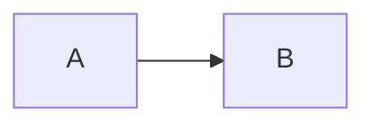

# Design note: Phase N, title

## Goal
One paragraph.

## What I am building
Components, interfaces, data flowing in and out.

## Diagram

## Key decisions and alternatives
Anything big becomes an ADR.

## What could go wrong
Edge cases, failure modes, performance risks.

## How I will know it works
Tests, metrics, exit criteria from the roadmap.

## Review notes
Feedback from review (Claude or a person) and what I changed.
