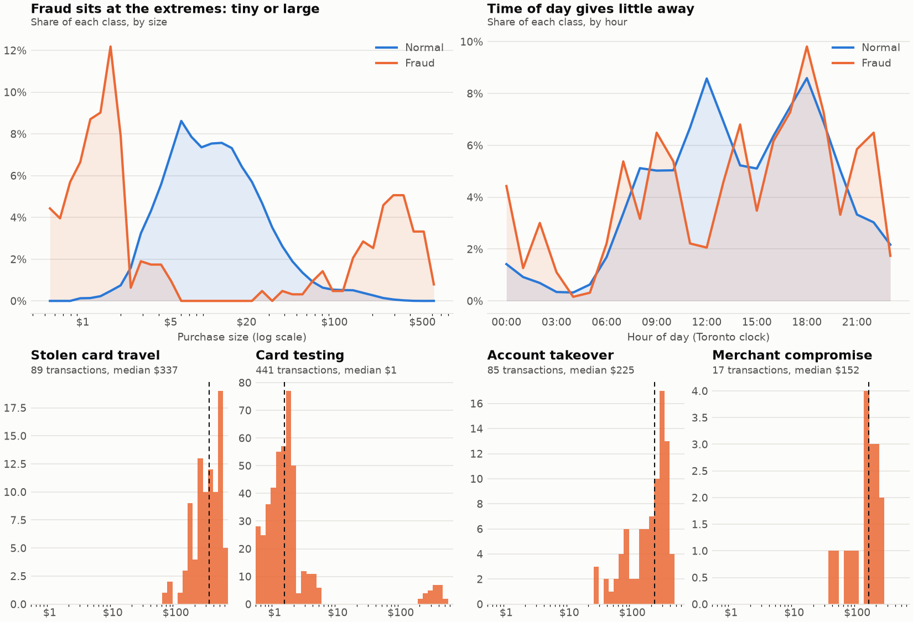

# Design note: Phase 1, synthetic world

> Draft this with Claude before writing code: Claude asks the prompts below, the author answers in their own words, Claude writes them up, and the author edits until it says what they mean. Stories and requirements are in `docs/07-roadmap.md` (P1-1 to P1-7, P1-R1 to P1-R6).

## Goal
Produce a believable, labelled dataset to a Parquet file: realistic normal Toronto customers plus four fraud patterns, with ground truth recorded separately. Later phases train and test on it, so what Phase 1 gets wrong, every later phase inherits. (Roadmap: P1-1 to P1-7.)

## What does a normal customer look like?
Home city, typical merchants, spend distribution, time-of-day habits, devices.

Author's description (first pass):

* **Home:** Toronto. Daily movement is local, between a home area (for example North York) and downtown, with occasional trips "here and there" around the city.
* **Channel:** mostly online. Sometimes in person at convenience stores and restaurants.
* **Spend:** typically about $5 to $20 on a day.
* **Timing:** varies; not a strong habit.

Notes so far:

* Online-heavy means `device_id` matters: each customer needs a small, stable set of devices (a phone, maybe a laptop).
* Two anchor areas (home and downtown) give a normal travel distance of roughly 10 to 20 km. That is the baseline that "impossible travel" has to stand out from.
* Because timing varies, `hour_of_day` will be a weak fraud signal. That is realistic, and it stops the data being too easy.
* **Occasional large purchase:** things like $150 headphones. These are legitimate outliers, so a big amount alone must not mean fraud.
* **Trips:** the customer travels outside Toronto about every 3 to 4 months, and the card is used there. So "far from home" alone must not mean fraud either. What separates a trip from stolen-card travel is speed and context: a trip has a plausible journey between two purchases, and spending afterwards fits the customer.
* Still to decide: exact numbers (trip length, purchases per trip, how often big purchases happen).

## Fraud patterns
For each: what happens, what signal makes it detectable, what fraction of traffic.
1. Stolen card travel (proposed by Claude at the author's request; author to review):
   * What happens: after a normal in-person purchase in Toronto, the same card is used in person in a far-away city (for example Vancouver, Calgary or Montreal) 20 to 90 minutes later. One to three purchases, mostly electronics and gift cards, $150 to $600 each.
   * Signal: implied speed (distance divided by time since the last purchase), plus amount far above the customer's norm.
   * Harder variant: longer gaps (3 to 6 hours) and smaller purchases ($60 to $300, against $150 to $600 for the easy variant), so the speed is only borderline plausible and the amount looks like an ordinary big buy. The model then needs more than speed and amount. (Amounts changed after the first plot, see Results.)
   * Legitimate look-alike: a real trip has a believable journey time between the last home purchase and the first one in the new city, and spending afterwards fits the customer.
   * Share: about 30% of fraud cases.
2. Card testing (proposed by Claude at the author's request; author to review):
   * What happens: online, 5 to 15 tiny purchases ($0.50 to $1.99) in 2 to 10 minutes, mostly at merchants this card has never used, sometimes followed by one larger purchase ($200 to $500) if the probes pass.
   * Signal: a burst of small transactions (`txn_count_1m`, `small_txn_count_10m`), new merchant, ecommerce channel.
   * Harder variant: slower probing, one every 5 to 10 minutes at $1 to $5.
   * Legitimate look-alike: an honest customer buying coffee, a transit top-up and a snack within 15 minutes at familiar merchants.
   * Share: about 35% of fraud cases.
3. Account takeover (proposed by Claude at the author's request; author to review):
   * What happens: over a few hours, 1 to 4 online orders at merchants the card has never used, from a device never seen on this card, $100 to $400 each.
   * Signal: new device plus new merchant plus unusual amount (`is_new_device`, `is_new_merchant`, `amount_zscore`). No single one is conclusive.
   * Harder variant: moderate amounts ($25 to $90) in a category the customer sometimes uses, so only the new device stands out.
   * Legitimate look-alike: the customer gets a new phone and buys $150 headphones at a merchant they have used before.
   * Share: about 25% of fraud cases.
4. Merchant compromise (proposed by Claude at the author's request; author to review):
   * What happens: a small merchant is breached. Over a few days, many different cards that used it later show fraud elsewhere: one $30 to $250 online purchase each at an unfamiliar merchant (changed from $80 to $250 after the first plot).
   * Signal: hard from a single card; visible across cards that share a merchant. Treated as a stretch goal in the roadmap.
   * Legitimate look-alike: an ordinary busy merchant that many customers happen to use.
   * Share: about 10% of fraud cases.

Shares of fraud cases add to 100%: travel 30, testing 35, takeover 25, compromise 10. Overall fraud is about 1% of all transactions.

## What could make the data unrealistically easy?
(If the model gets 0.99 PR-AUC, the data is probably too easy. How will you prevent that?)

Proposed by Claude; author to review.

* **Fraud always has one giveaway.** If every fraud transaction has an obvious flag (for example always 3,000+ km away, always over $300), a model learns that single rule. Prevention: each pattern has a harder variant, and some fraud looks only mildly unusual.
* **Normal behaviour is too tidy.** If honest customers never do anything odd, odd means fraud. Prevention: honest big purchases (about $150 headphones), trips every 3 to 4 months, new phones with new devices, and bursts of small familiar purchases. The look-alikes in each pattern are generated on purpose.
* **Timing is too regular.** If fraud is always at 3 am, hour of day gives it away. Prevention: customers' timing varies, and fraud timing is spread across the day.
* **Generator leakage.** If fraud rows are generated differently from normal rows in some hidden way (a distinct id format, different rounding, an always-null field), a model can learn the generator, not the fraud. Prevention: normal and fraud rows go through the same code path and the same schema, and ground truth stays in a separate column.
* **Designing the data around the features.** If a pattern is defined as "whatever the planned features catch", detection is circular. Prevention: define patterns from how fraudsters behave, then see which features catch them.
* **Too few examples of a pattern.** Merchant compromise at 10% of about 1% of transactions is a small count. Prevention: check pattern counts after generation and size the population to give enough of each.
* **Sanity check later:** if the Phase 2 model reaches PR-AUC near 0.99, treat it as a bug in the data first and investigate before celebrating.

## How I will know it works

Proposed by Claude; author to review. These map to the roadmap exit criteria and tests for Phase 1.

* **Fraud rate is about 1%** (model card target 0.5 to 1%), and each of the four patterns has enough cases to learn from (P1-R1).
* **Same seed, same file.** Running twice with the same seed gives byte-identical output (P1-7).
* **Every row is valid.** All rows pass `fraudcore.schemas.Transaction`, with integer-cent amounts, UTC `event_time`, and rows ordered by time (P1-R2, P1-R3).
* **Ground truth is separate.** `is_fraud` and the pattern name are stored in their own columns, never inside the `Transaction` contract (P1-6).
* **Each pattern shows its signal.** Per-pattern unit tests: stolen-card travel produces implied speeds far above plausible travel; card testing produces bursts of sub-$2 online purchases; account takeover shows a new device plus an unusual amount.
* **Plots look plausible.** Normal vs fraud: amount distribution, hour of day, distance from home. Honest trips and large purchases appear in the normal data, and the look-alikes overlap fraud somewhat.
* **No hidden giveaway.** Normal and fraud rows come from the same code path and schema.
* **Author can explain it.** What makes each pattern detectable, and why realistic normal behaviour matters as much as the fraud (roadmap "must explain").

## Results (generator 1.0.0, 1,000 customers, 30 days, seed 42)

`python -m gateway_sim.main --offline` then `python notebooks/phase1_plots.py`. Added after the code was written; the author's earlier review covered the sections above, not these changes.

| Check | Result |
|---|---|
| Fraud rate | 1.00% of 63,073 transactions |
| Fraud cases by pattern | 134 attacks: travel 43, card testing 42, takeover 36, compromise 13 (breaches of several cards each) |
| Same seed, same file | byte-identical Parquet (tested) |
| Honest typical purchase | median about $10, 90% under $35, 54% online, about 3.6% made while travelling |
| Ground truth | `is_fraud`, `fraud_pattern`, `attack_id`, `breached_merchant_id` in their own columns |

What the first plot taught, and what changed:

* **Honest sub-$2 purchases did not exist.** The first version forbade them, so any sub-$2 charge was fraud. The floor is now $1, and about 1.2% of honest purchases are under $2.
* **Attacks happened at uniformly random times.** Honest shopping peaks at lunch and early evening, so 3 am was a strong clue. Now 60% of attacks are timed like the victim's own shopping, and the hour of day gives little away.
* **Hard variants overlapped too little.** Lowered the amounts of the hard variants (travel $60 to $300, takeover from $25, compromise from $30).

Still too easy on amount, to be tested in Phase 2: 58% of fraud transactions are under $2 (honest: 1.2%), and only about 11% of fraud falls inside the $2 to $103 range that holds 96% of honest spending. Card testing is mostly a stream of tiny charges, so some of this is real, and 70% of fraud transactions are card-testing probes. If the Phase 2 model scores near 0.99 PR-AUC, check this first (raise the hard share, or fold fraud into more ordinary-looking amounts) before trusting the number.

Other limits: all amounts are in CAD, and times use fixed UTC offsets with no daylight saving. Online purchases carry the customer's own location, as an IP lookup would. Only about 134 fraud cases exist at this size, so Phase 2 will likely want more customers or days.
