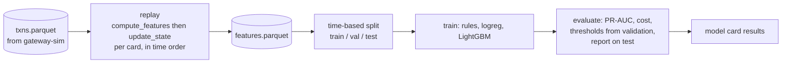

# Design note: Phase 2, offline model

> Drafted by Claude from the roadmap, the feature catalog and the model card, with the author's standing instruction to decide without asking. Every decision is listed so the author can veto it. Stories and requirements: `docs/07-roadmap.md` (P2-1 to P2-6, P2-R1 to P2-R8).

## Goal
Show, offline, that a model beats a hand-written rules baseline on PR-AUC and on expected cost, using the exact feature code the live service will run in Phase 3 and 4 (ADR-0006). If this phase is done well, Phase 3 is wiring.

## What I am building

| Piece | Where | Story |
|---|---|---|
| Distance (haversine) | `fraudcore/features/geo.py` | P2-2 |
| `compute_features`, `update_state` | `fraudcore/features/compute.py` | P2-1 |
| Replay Parquet through the feature code | `ml_platform/replay.py` | P2-3 |
| Rules baseline, logistic regression, LightGBM | `ml_platform/train.py` | P2-4 |
| Time-based split | `ml_platform/split.py` | P2-5 |
| Expected cost, threshold choice, metrics | `ml_platform/evaluate.py` | P2-6 |

## Feature conventions (decisions)
These make every feature a defined number for every transaction. They are written into `docs/04-feature-catalog.md`.

* **Windows** are `[event_time - W, event_time)`: an event exactly W ago counts, an event at the same instant or later does not. Only events strictly before the transaction can be seen (point-in-time).
* **Cold start** (empty state): counts and sums 0, `amount_zscore` 0, `secs_since_last_txn` / `km_from_last_txn` / `implied_speed_kmh` -1 ("unknown"), `is_foreign` 0, `is_new_device` and `is_new_merchant` 1 (never seen before is new). `is_new_device` is 0 for card-present transactions, which have no device.
* **`amount_zscore`**: Welford running mean and variance over the card's lifetime. Fewer than 3 prior amounts gives 0 ("not enough history"). The standard deviation has a floor of $1, so a card with identical past amounts does not produce infinite z-scores.
* **`implied_speed_kmh`**: distance divided by elapsed hours, with elapsed time floored at 60 seconds. Two purchases 5 seconds and 1 km apart then give at most 60 km/h, not 720.
* **Out-of-order events (F8)**: a late event is scored normally, never moves `last_*` backwards, and elapsed time is clamped at 0.
* **`hour_of_day`**: local mean solar time, `(UTC hour + round(longitude / 15)) mod 24`. No timezone database needed, and it works for online transactions, whose location is the customer's.
* **`is_foreign`**: the merchant country differs from the card's home country. Home country is the merchant country of the card's first transaction (a known limitation).
* **`mcc_risk_bucket`**: 0 normal, 1 elevated (electronics, jewellery, gift cards), 2 high (digital goods, crypto, money transfer, gambling).
* **Purity**: neither function changes its inputs. `update_state` returns a new `CardState`.

## Model and evaluation decisions
* **Rules baseline:** hand-written thresholds on the features (impossible speed, burst of small charges, new device with a large amount, high-risk category with a large amount). It must be beaten.
* **Models:** rules, logistic regression (scaled features), LightGBM. Isolation Forest waits for Phase 7.
* **Split:** by `event_time`, never random: first 60% train, next 20% validation, last 20% test, with a **1-day gap** between windows so an attack that straddles a boundary cannot leak (merchant-compromise campaigns span days).
* **Labels:** the simulator's ground truth is used directly. Late-arriving labels are not simulated until Phase 4 and 7 (documented limitation).
* **Metrics:** PR-AUC first. Then precision and recall at the chosen operating point, expected cost per 1,000 transactions, calibration curve. Never accuracy.
* **Cost matrix** (model card): missed fraud costs the amount, a false decline $15, a review $3, correct decisions $0. Assumption: a REVIEW is resolved correctly by the analyst, at $3 either way.
* **Thresholds:** grid search over `(review_t, decline_t)` on validation minimising expected cost, then report on test only.
* **Data size:** use 4,000 customers for 60 days (about 1,000 attacks) instead of the Phase 1 default.

## "Too easy" plan
Phase 1 left a known risk: amount alone separates a lot of fraud. So before trusting any number:
1. Report an **amount-only** score as a sanity baseline.
2. If LightGBM PR-AUC is near 0.99, treat it as a data problem first: raise the hard-variant share, cap probes per attack, add honest small-burst look-alikes (see the Phase 1 note), regenerate, and re-run.
3. Report PR-AUC **per pattern** so a pattern that is trivially caught is visible.

## What could go wrong
* **Leakage:** computing features after updating state, or using any ground-truth column as an input. Mitigation: tests for the ordering, and the feature table never includes ground truth except as the label.
* **Slow replay:** pure Python per transaction. Fine at 400k rows; revisit if not.
* **Overfitting thresholds to validation.** Mitigation: report on the untouched test window.
* **Class imbalance:** 1% fraud. Handle with `scale_pos_weight` or class weights, and judge by PR-AUC, not accuracy.

## How I will know it works
* Feature unit tests (one point-in-time boundary test per windowed feature), and replay of a small hand-built sequence equals hand-computed features.
* LightGBM beats rules on PR-AUC and on expected cost on the test window, with a time-based split.
* `docs/05-model-card.md` results table and thresholds are filled in.
* Parity of offline replay with the online path is proven later, in Phase 4.

## Results and what changed along the way

Full numbers, tables and the figure are in `docs/05-model-card.md`. In short, on the untouched test window LightGBM reaches PR-AUC 0.966 against 0.122 for the rules baseline, and an expected cost of $38.42 per 1,000 transactions against $226.77 (approving everything: $678.63).

Decisions made during the build, beyond the ones above:

* **The "too easy" plan was needed.** The first run (generator 1.0.0) scored 0.993 PR-AUC. I did not report it as a win. I measured, found the causes (always-far online fraud, noise-free honest locations, no honest small bursts or new devices, fraud timing ignoring the clock) and released generator 1.1.0 with honest noise and mixed intruder locations. Changes were made once for realism, not tuned to a target.
* **Ablation added** (`mlp ablate`): the catalog requires "with vs without" for features. No single feature carries the model.
* **PR-AUC and cost disagree**, and cost is the one that matters for the business. Logistic regression has the second best PR-AUC but a cost no better than rules.
* **Per-pattern and attack-level numbers** were added to the evaluation because the headline is inflated by easy card-testing probes (73% of fraud rows).
* **Calibration bins** are finer in the high-score tail, because equal-size deciles collapse at 1% fraud.
* **Model files** live in `models/versions/vNNNN/` (git-ignored) and are written by `mlp train`. LightGBM needed the `libomp` system library on macOS (`brew install libomp`).
* **Deferred:** the live path (Phase 3) still needs `pred_contrib` reason codes; the rules baseline moves to `scoring/rules.py` there.
